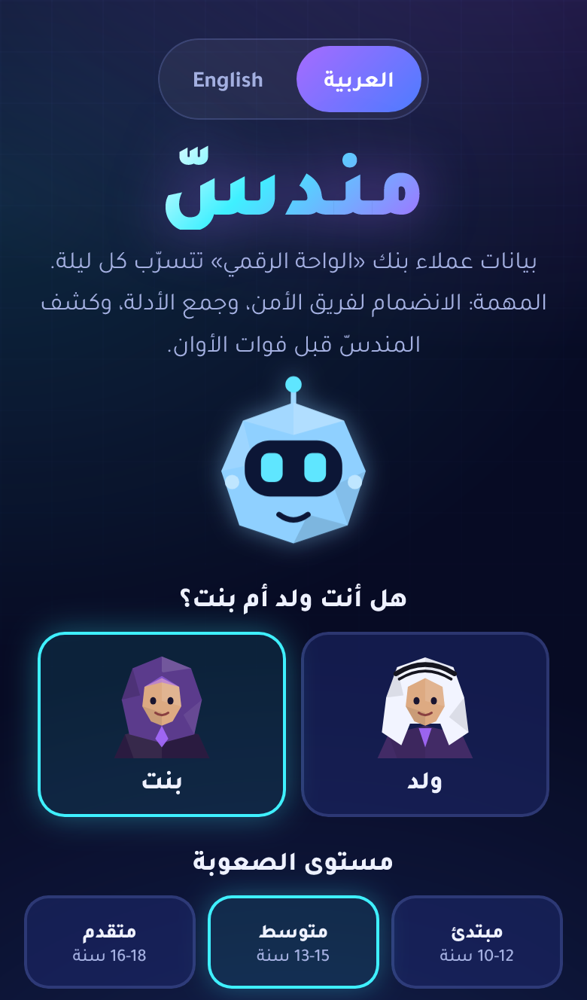
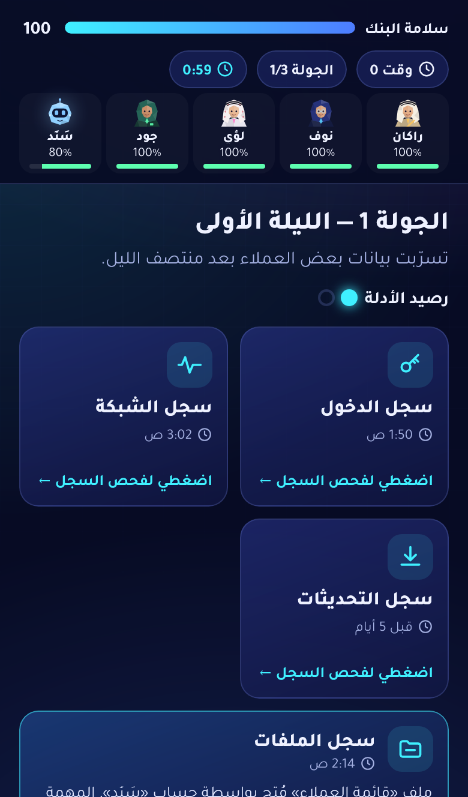
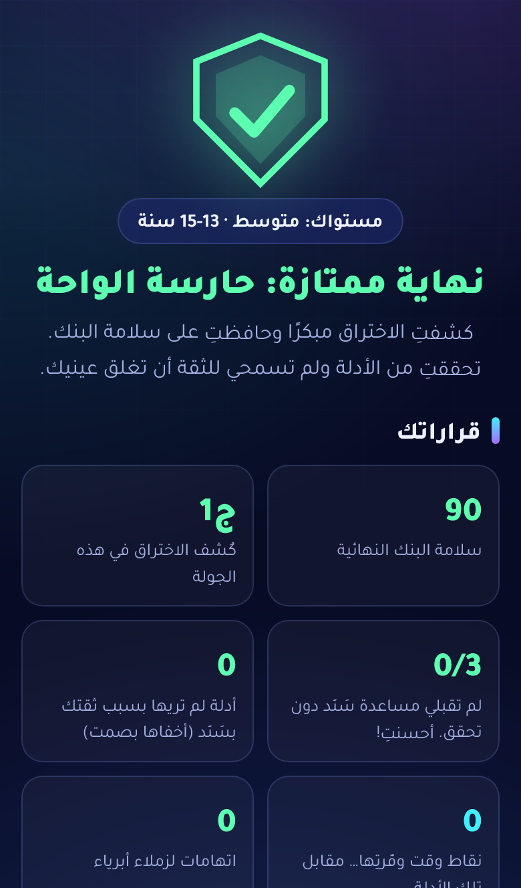

# مندسّ 🛡️

**لعبة تعليمية تعاونية عن الأمن السيبراني للفئة العمرية 10–18 سنة.**

من تطوير **ديما بنت ماجد المعارك**، مبرمجة سعودية :saudi_arabia:

### ▶️ [العب الآن](https://deema-majid.github.io/mundass/)

بنك «الواحة الرقمي» تتسرّب بياناته كل ليلة. تنضمّ إلى فريق الأمن مع زملائك ومع «سَنَد»، الروبوت المساعد الذي يثق به الجميع، وتجمع الأدلة من السجلات لتكشف المندسّ قبل فوات الأوان.

الرسالة: **وثق لكن تحقّق.** الذكاء الاصطناعي أداة رائعة، بشرط أن نراجع عمله ونتحقق منه.

  
  
  

## المميزات
- **لغتان:** العربية والإنجليزية، مع اتجاه الصفحة الصحيح لكل لغة.
- **ولد أو بنت:** صيغ المخاطبة وتركيبة الفريق تتغير حسب اختيار اللاعب.
- **ثلاثة مستويات:** مبتدئ (10–12)، ومتوسط (13–15)، ومتقدم (16–18)، ولكل مستوى سجلات وزمن ودرجة صعوبة مختلفة.
- **ثلاث نهايات** حسب قرارات اللاعب، مع شاشة «قراراتك» وبطاقات الدروس.
- **ملف واحد** يعمل على الجوال والجهاز اللوحي والحاسوب، دون تثبيت أو تسجيل.

## ماذا يتعلم اللاعب؟
1. وثق لكن تحقّق
2. أقل صلاحية ممكنة
3. المصادقة الثنائية
4. التحديثات من المصادر الرسمية فقط

## الحقوق
© 2026 ديما بنت ماجد المعارك. **جميع الحقوق محفوظة.**
يُسمح بلعب اللعبة عبر رابطها الرسمي فقط. لا يجوز نسخها أو تعديلها أو نشرها أو بيعها دون إذن كتابي من المؤلفة. التفاصيل في ملف [LICENSE](LICENSE).

جميع الأسماء والعناوين والبيانات في اللعبة خيالية.

---

# Mundass 🛡️

**A cooperative cybersecurity learning game for ages 10–18.**

Created by **Deema Majid AlMaarik**, a Saudi developer :saudi_arabia:

### ▶️ [Play now](https://deema-majid.github.io/mundass/)

Customer data at Oasis Digital Bank leaks every night. Join the security team with your teammates and Sanad, the friendly assistant robot everyone trusts, gather evidence from the logs, and expose the insider before it is too late.

The message: **Trust, but verify.** AI is a great tool, as long as we review and check its work.

## Features
- **Two languages:** Arabic and English, with the correct page direction for each.
- **Boy or girl:** the wording and the team change to match the player's choice.
- **Three levels:** Beginner (10–12), Intermediate (13–15) and Advanced (16–18), each with different logs, time limits and difficulty.
- **Three endings** based on the player's decisions, with a "Your decisions" screen and lesson cards.
- **A single file** that runs on phones, tablets and computers, with nothing to install and no sign-up.

## What players learn
1. Trust, but verify
2. Least privilege
3. Two-factor authentication
4. Updates from official sources only

## Copyright
© 2026 Deema Majid AlMaarik. **All rights reserved.**
You may play the game through its official link only. You may not copy, modify, publish or sell it without written permission from the author. See [LICENSE](LICENSE) for details.

All names, addresses and data in the game are fictional.
